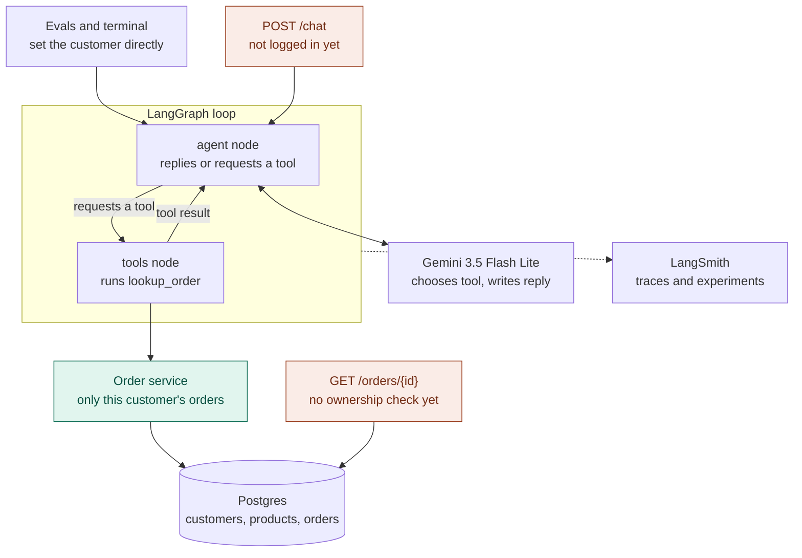

# Architecture

Current state, before login. This page is updated as the system changes.

Teal marks a rule enforced in code. Coral marks a known gap that login will close.

## How a request flows

1. A request reaches the graph with a customer ID in its run configuration. The ID does not go through the model.
2. The agent node calls Gemini with the system prompt, the conversation and the tool definition. Gemini either replies or requests `lookup_order` with an order number.
3. The tools node runs `lookup_order`, which reads the customer ID from `ToolRuntime`. The model cannot see or change it.
4. The order service queries Postgres for that order only if it belongs to that customer.
5. The result goes back to the agent node, and Gemini writes the reply.

Each run is limited by a recursion limit, and each run can be traced in LangSmith.
