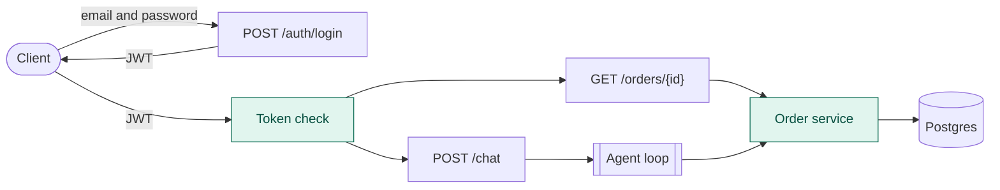
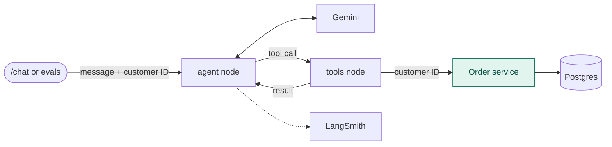

# Architecture

Current state, with login. This page is updated as the system changes.

Green boxes enforce a rule in code.

## Request path

1. The client logs in with an email and password. The server checks the password hash and returns a signed JWT holding the customer ID, valid for 30 minutes.
2. Every request to `/chat` or `/orders` sends the token. A missing, invalid or expired token gets a 401 before any route code runs.
3. Both routes pass the customer ID from the token to the order service, which returns an order only if it belongs to that customer.

## Inside the agent loop

1. `/chat` puts the customer ID from the token into the run configuration. Evals and the terminal set the same value directly. It does not go through the model.
2. The agent node sends the system prompt, the conversation and the tool definition to Gemini 3.5 Flash Lite, which either replies or requests `lookup_order` with an order number.
3. The tools node runs `lookup_order`, which reads the customer ID from `ToolRuntime`. The model cannot see or change it.
4. The result goes back to the agent node, and Gemini writes the reply.

Each agent run is limited to 10 graph steps, and each run can be traced in LangSmith.
